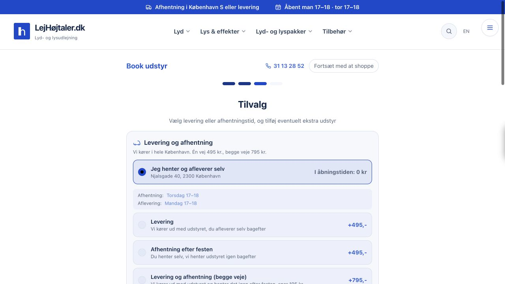
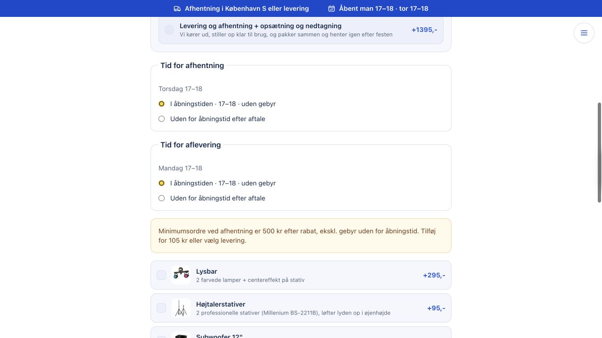
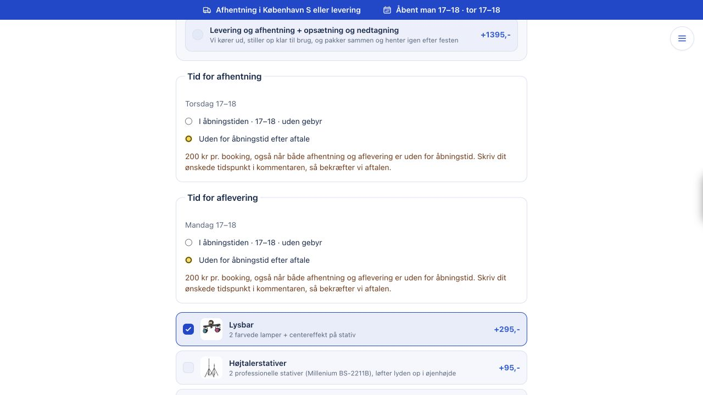
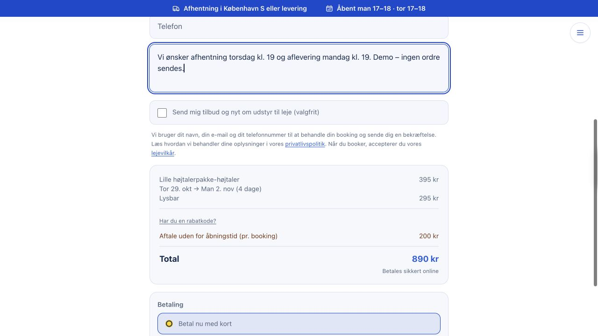
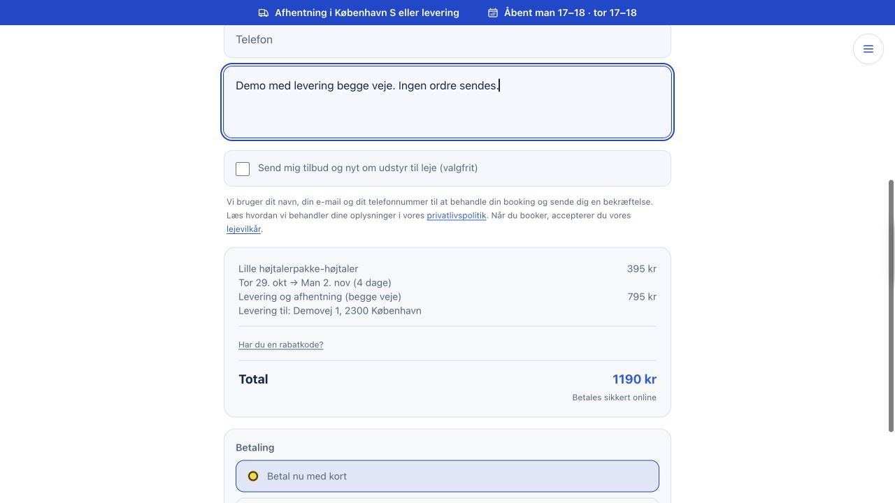
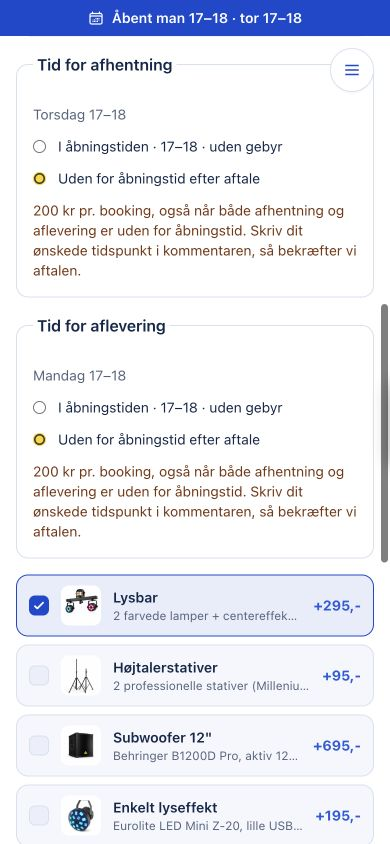
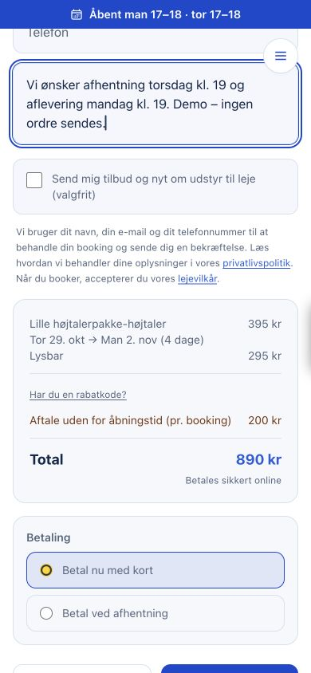
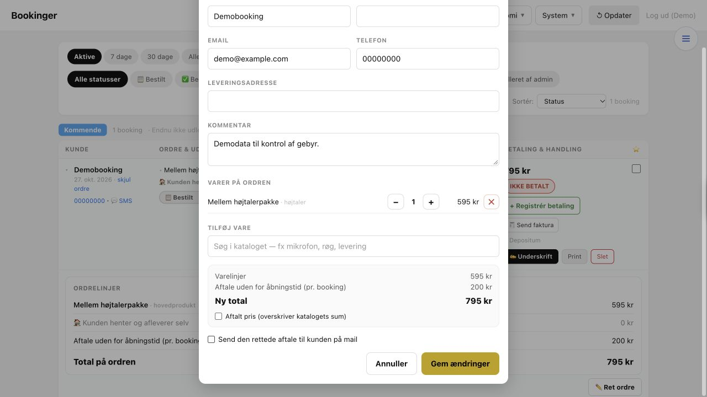

# Lejhøjtaler – Sådan virker opdateringen

27. oktober 2026. Klar til gennemgang; endnu ikke offentliggjort.

Billederne er fra den lokalt kørende hjemmeside med fiktive demodata. Ingen kundeordre eller betaling er sendt.

## 1. Ny adresse og faste åbningstider

Vælg selvafhentning på Njalsgade 40, 2300 København. De faste tider er mandag og torsdag kl. 17–18.

## 2. Minimumsordre ved selvafhentning

En ordre under 500 kr kan ikke gå videre. Beskeden viser, hvor meget der mangler; tilføj udstyr eller vælg levering. Minimum regnes efter rabat og uden aftalegebyret.

## 3. Aftal et tidspunkt uden for åbningstiden

Vælg “Uden for åbningstid efter aftale”. Den viste version lægger 200 kr til én gang pr. booking, også når både afhentning og aflevering ligger uden for åbningstiden.

## 4. Skriv tidspunktet og se totalen

Skriv de ønskede tidspunkter i kommentaren. Her bliver 395 kr for højtalere + 295 kr for lys + 200 kr i aftalegebyr til 890 kr. Tidspunktet skal bekræftes af udlejeren.

## 5. Levering fritager for minimumsordren

Ved levering begge veje forsvinder begge tidsvalg og aftalegebyret. Eksemplet indeholder udstyr for 395 kr og kørsel for 795 kr: i alt 1.190 kr. Ved kørsel én vej gælder tidsvalget stadig for den anden vej.

## 6. Tidsvalg på mobil

De samme muligheder vises på mobilen. Teksten forklarer, at de 200 kr er ét samlet aftalegebyr.

## 7. Samlet pris på mobil

Kontrollér gebyret og totalen, før du vælger betaling. Priser og minimum kontrolleres igen på serveren.

## 8. Gebyret følger med i administrationen

Åbn ordren og vælg “Ret ordre”. Gebyret står særskilt og genberegnes ved ændring af kørslen. En eksplicit aftalt pris kan fortsat bruges. Gebyret fremgår også særskilt på standardfakturaen.

## Samlede afklaringer

- Er afhentningsadressen endeligt Njalsgade 40, og hvordan beskrives indgangen? Frederik nævnte først kælderen mellem 43 og 45. Firmaets registrerede adresse er bevaret, indtil den er bekræftet.

- Er gebyret 200 kr pr. booking eller pr. afhentning/aflevering? Den færdige version bruger én opkrævning pr. booking.

- Skal minimumsordren være 500 kr efter rabat, og fritager afhentning efter festen alene også? Den færdige version bruger efter rabat og fritager ved enhver tilvalgt kørsel.

Publicering afventer Philips udtrykkelige go.

Kontrol: 1.305 tests bestået, 7 sprunget over. Produktionens build er gennemført. Betaling og mail er testet med simulerede udbydere.
